<div align="center">

# Evil Nun: The Broken Mask — Mod Menu

**A feature-rich ImGui cheat menu for *Evil Nun: The Broken Mask* (UE5)**

*Evil Nun: The Broken Mask*（邪恶修女：破碎面具）功能完整的 ImGui 作弊菜单

[](#-安装--installation)
[](#-构建--building)
[](#-构建--building)
[](LICENSE)

[简体中文](#中文说明) | [English](#english)

</div>

---

## 中文说明

为恐怖解谜游戏 **《Evil Nun: The Broken Mask》（邪恶修女：破碎面具）** 制作的注入式作弊菜单。基于 Dumper-7 逆向 SDK + Dear ImGui 绘制界面，通过 hook DXGI `Present` 渲染，支持**中 / 英双语版本**（编译期选择，见 [发布页](../../releases) 的 `CN.*.dll` / `EN.*.dll`）。

### ✨ 功能特性

| 页面 | 功能 |
|---|---|
| **玩家** | 上帝模式（免疫一切伤害与击杀）、无限体力、恢复生命；走路/跑步/下蹲速度修改、解锁跳跃（游戏原生未绑定跳跃，由 mod 驱动）、穿墙飞行（F4）；获得面具、设置传送点数 |
| **道具** | 扫描全部可拾取物（任务道具 / 物理杂物自动分组），支持搜索过滤与中文别名；按距离在玩家面前生成任意物品；任务道具生成时自动转移交互身份（保险丝盒等场景交互可正常识别）；一键强制加载全部流式子关卡补全列表 |
| **修女 AI** | 冻结 / 失明 / 失聪修女；原生死亡流程击杀与复活（死亡时长可调、可永久死亡）；修女与玩家双向传送；体型缩放；实时查看修女状态（追击/平静）与感知参数（速度/视野/听觉） |
| **传送** | 游戏自带导航路点按官方分类聚合的全部房间/场景 + 出生点列表，显示实时距离，一键传送（自动触发目标区域子关卡加载） |
| **ESP** | 修女方框（追击红/平静橙/死亡灰，标注种类与状态）、道具位置高亮（任务道具青色/物理杂物灰蓝），支持名称过滤与距离显示；菜单关闭时 ESP 依然工作 |
| **视觉** | FOV 修改、Gamma 夜视、启用游戏原生控制台作弊 |
| **对象** | 准星选取任意场景对象（F2），查看名称/类/位置/距离，传送过去、拉到面前、删除 |
| **世界** | 游戏版本、关卡、天数、玩家状态查询；一键完成当前任务 |

### ⌨️ 快捷键

| 按键 | 功能 |
|---|---|
| `F1` | 显示 / 隐藏菜单 |
| `F2` | 选取视线中心对象 |
| `F4` | 切换穿墙飞行 |
| `END` | 卸载 Mod |

### ️ 界面截图

> 菜单打开时左上角显示注入状态水印；ESP 在菜单关闭时依然工作。

| 玩家 | 道具生成 | 修女 AI | 传送 |
|---|---|---|---|
| 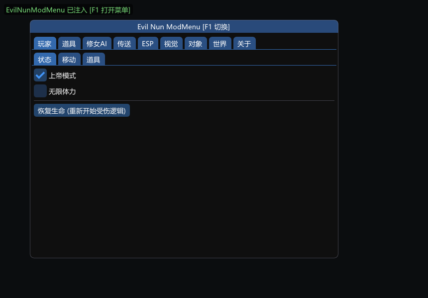 | 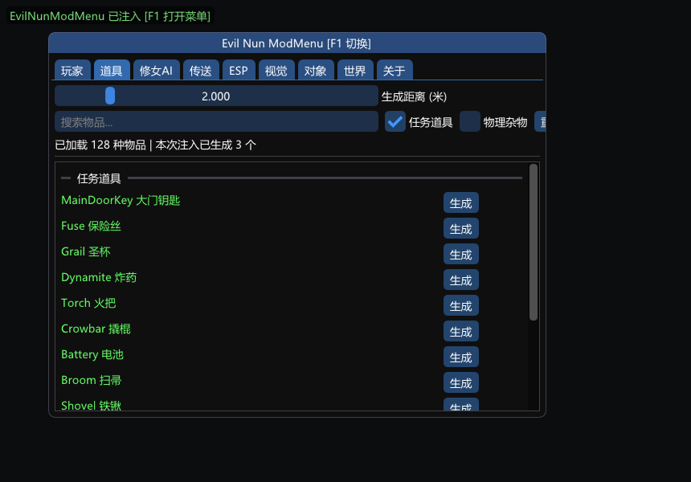 | 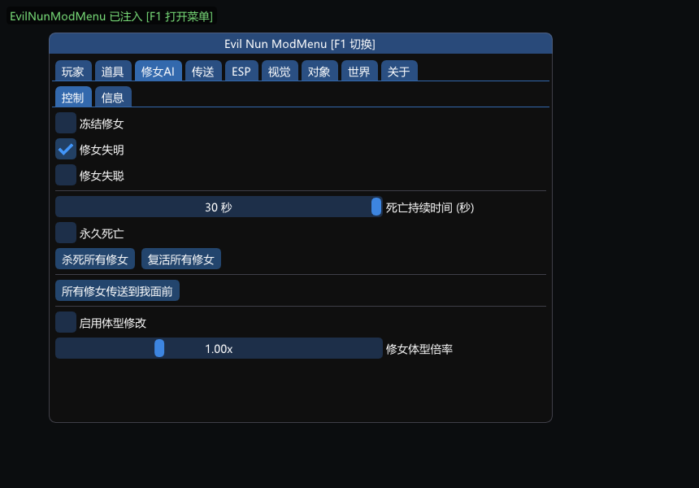 | 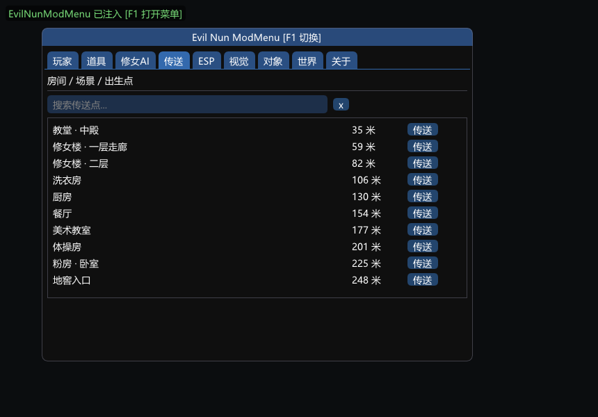 |

| ESP | 视觉 | 对象选取 | 世界 |
|---|---|---|---|
| 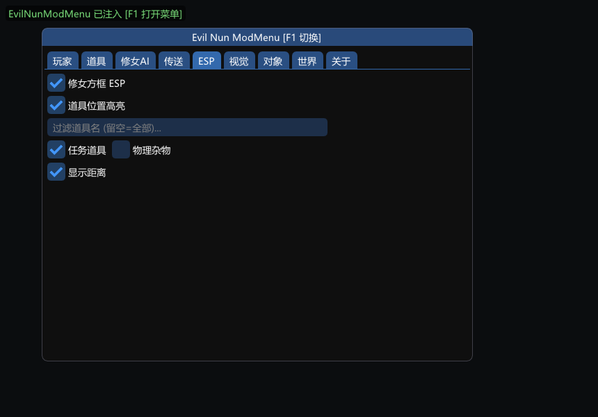 | 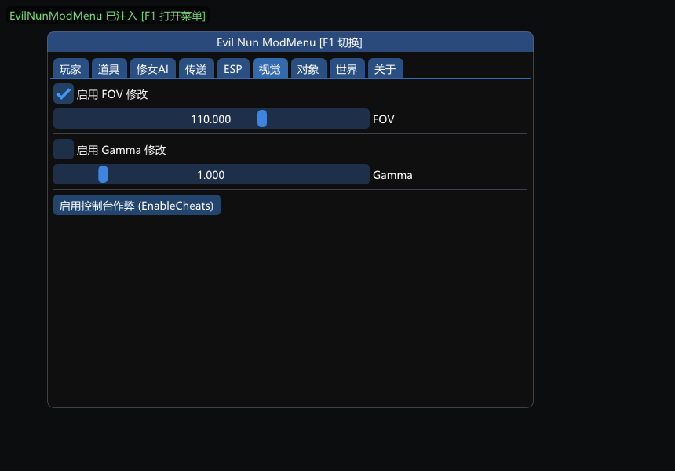 | 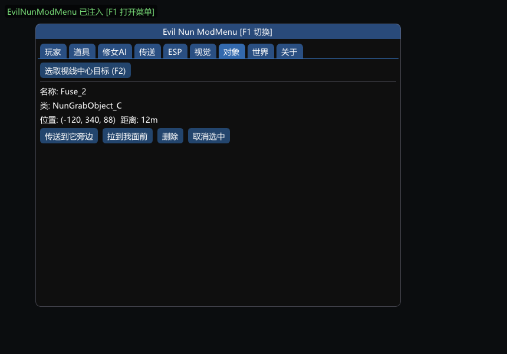 | 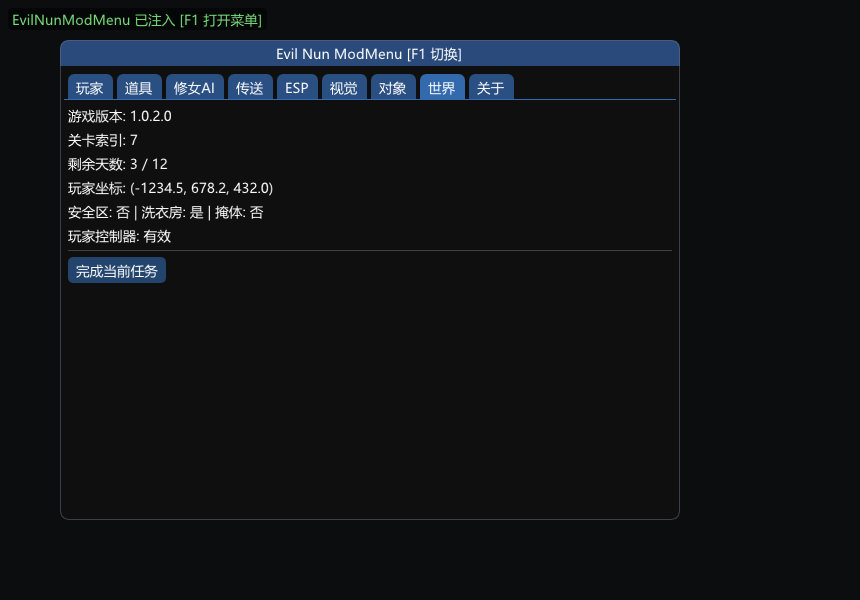 |

### 📥 安装 / Installation

1. 从 [Releases](../../releases) 下载对应语言的 DLL：
   - `CN.EvilNunModMenu.dll` — 中文菜单
   - `EN.EvilNunModMenu.dll` — 英文菜单
2. 重命名为你的注入器所使用的文件名（例如 `version.dll`）；
3. 用你惯用的 DLL 注入器注入游戏进程（或直接放入游戏 `Binaries\Win64\` 目录，视注入方式而定）；
4. 进入游戏后按 `F1` 打开菜单。

> 菜单使用系统自带的微软雅黑渲染中文，无需额外字体文件。英文版同样加载 CJK 字体，因为游戏内物品名可能是中文。

### 🔨 构建 / Building

依赖：**CMake ≥ 3.16 + Ninja + MinGW-w64 (g++ ≥ 13)**。

本仓库不包含游戏逆向 SDK（Dumper-7 输出，体积大且随游戏版本失效）。构建前请自行 dump 一份 *EvilNun: The Broken Mask* 的 CppSDK，并放到与本仓库平级的位置：

```
<你的工作区>/
├── dumper/CppSDK/     ← 自备的 Dumper-7 SDK (Basic.hpp / SDK.hpp 等)
└── EvilNun-.../       ← 本仓库
```

若 SDK 路径不同，修改 `CMakeLists.txt` 中的 `SDK_DIR`。

```bash
# 中文版 (默认)
cmake -S . -B build -G Ninja -DMODMENU_LANG_EN=OFF
cmake --build build --parallel

# 英文版
cmake -S . -B build -G Ninja -DMODMENU_LANG_EN=ON
cmake --build build --parallel
```

产物为 `build/EvilNunModMenu.dll`（静态链接 MinGW 运行时，无外部依赖）。

在 PowerShell 下一键构建双语并发布包（自动输出 `dist/CN.*.dll`、`dist/EN.*.dll` 并做语言自检）：

```powershell
powershell -File package_langs.ps1
```

### 🏗️ 技术要点

- **渲染**：hook `IDXGISwapChain::Present`（D3D11 / D3D12 双后端自适应），resize 时安全重建；
- **输入**：WndProc hook 将窗口消息翻译为事件入队，渲染线程消费（ImGui 非线程安全，禁止跨线程直写）；菜单打开时拦截游戏输入并接管光标（hook `SetCursorPos` 阻止游戏每帧把光标拽回中心）；
- **稳定性**：换关卡 / 回主菜单触发 GC 销毁风暴时，3 秒冻结一切游戏对象访问防悬垂指针崩溃；对象访问前一律做 GObjects 槽位校验；
- **多语言**：`lang.h` 编译期 `L("中文", "English")` 宏二选一；物品分组内部键跨语言固定，两份 DLL 逻辑与日志完全一致。

### ⚠️ 免责声明

仅供个人学习与研究。请在**离线/单人模式**下使用，不要在联机环境使用本工具。使用者需自行承担封号等风险。本 Mod 与 Keone 或《Evil Nun》官方无任何关联。

---

## English

An injector-based cheat menu for the horror puzzle game **Evil Nun: The Broken Mask** (UE5). Built on a Dumper-7 reverse-engineered SDK with a Dear ImGui overlay, rendered via a DXGI `Present` hook. Ships in **two language builds** — `CN.*.dll` (Chinese) and `EN.*.dll` (English), selected at compile time; see [Releases](../../releases).

### ✨ Features

| Tab | Features |
|---|---|
| **Player** | God Mode (immune to all damage/kills), infinite stamina, health restore; walk/run/crouch speed override, unlock jump (the game ships no jump binding — the mod drives it), noclip fly (F4); grant quest mask, set teleport charges |
| **Items** | Scans every pickable (auto-grouped: quest items / physics props), search filter with aliases; spawn any item in front of you at a chosen distance; spawned quest items get their interaction identity transferred so world triggers (fuse boxes etc.) accept them; force-load all streaming sublevels to complete the list |
| **Nun AI** | Freeze / blind / deafen nuns; kill & revive via the native death flow (configurable death duration, permanent death); teleport nuns ↔ player bidirectionally; body-scale override; live status (chasing/calm) and perception parameters (speed/sight/hearing) |
| **Teleport** | All rooms/areas aggregated from the game's own navigation waypoints plus spawn points, with live distances and one-click teleport (auto-loads the destination sublevel first) |
| **ESP** | Nun boxes (red chasing / orange calm / grey dead, labeled with type and state), item highlight (cyan quest / blue-grey physics), name filter and distance display; keeps working while the menu is closed |
| **Visual** | FOV override, gamma (night vision), enable native console cheats |
| **Object** | Pick any scene actor at crosshair (F2): inspect name/class/position/distance, teleport to it, pull it to you, delete it |
| **World** | Game version, level, day counter, player flags; complete current mission |

### ⌨️ Hotkeys

| Key | Action |
|---|---|
| `F1` | Toggle menu |
| `F2` | Pick object at crosshair |
| `F4` | Toggle noclip fly |
| `END` | Unload the mod |

### 🖼️ Screenshots (English build)

| Player | Items | Nun AI | Teleport |
|---|---|---|---|
| 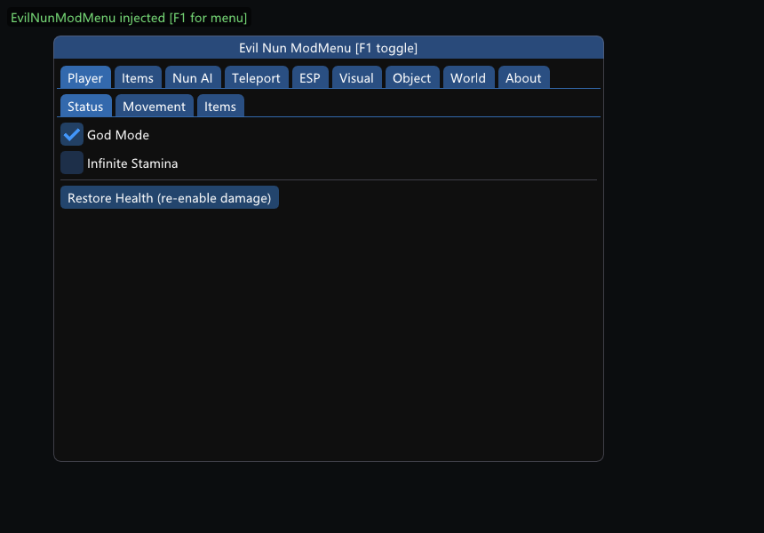 | 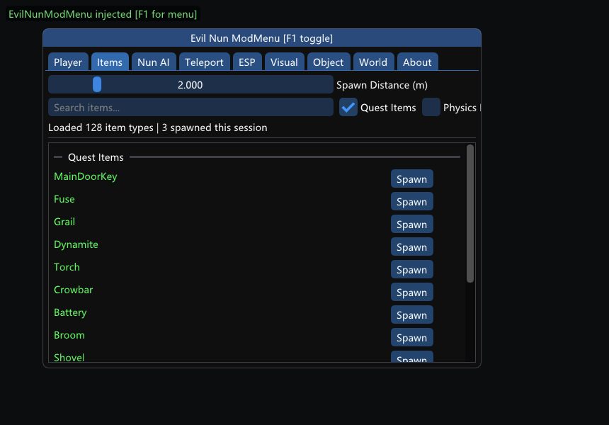 | 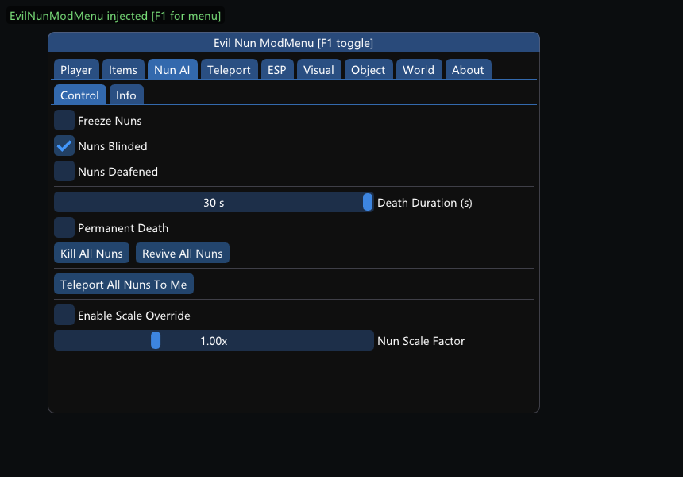 | 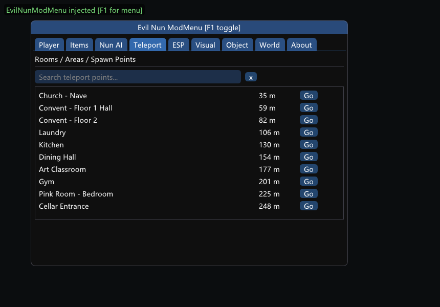 |

| ESP | Visual | Object | World |
|---|---|---|---|
| 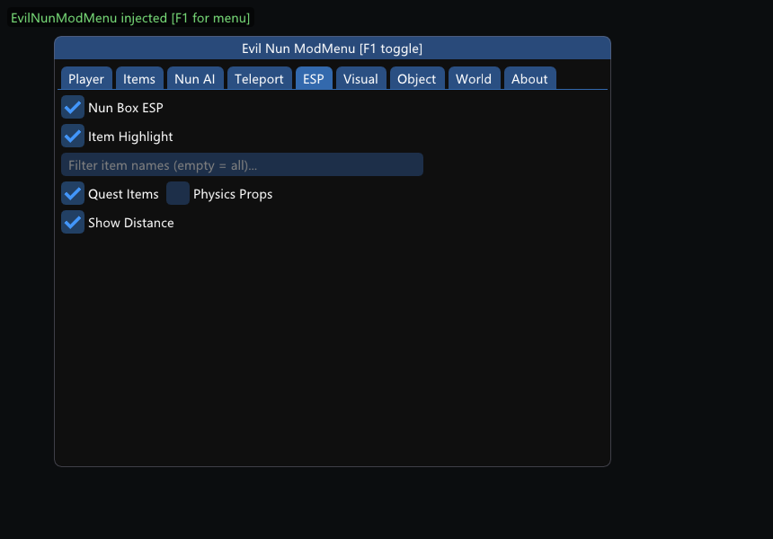 | 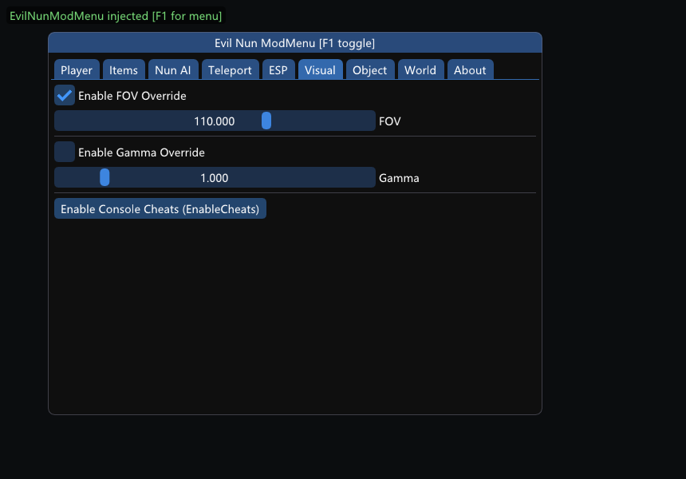 | 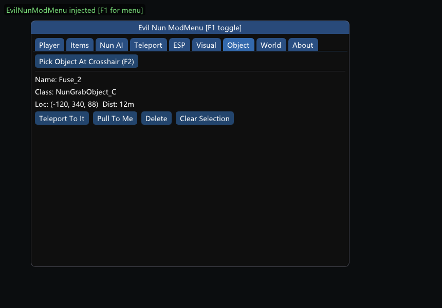 | 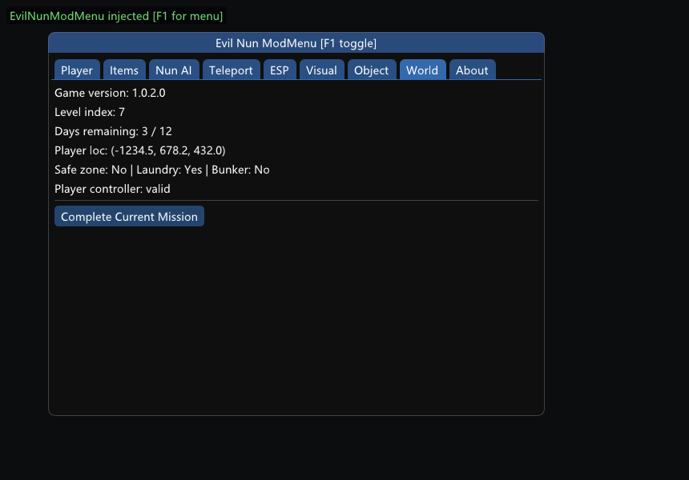 |

### 📥 Installation

1. Download the DLL for your language from [Releases](../../releases);
2. Rename it to whatever your injector loads (e.g. `version.dll`);
3. Inject into the game process (or drop it next to the game executable, depending on your method);
4. Press `F1` in-game to open the menu.

### 🔨 Building

Requires **CMake ≥ 3.16 + Ninja + MinGW-w64 (g++ ≥ 13)**.

The game SDK (Dumper-7 output) is **not** included — dump *Evil Nun: The Broken Mask* yourself and place it next to this repo:

```
<workspace>/
├── dumper/CppSDK/     ← your own Dumper-7 SDK
└── EvilNun-.../       ← this repo
```

Adjust `SDK_DIR` in `CMakeLists.txt` if you put it elsewhere.

```bash
# English build
cmake -S . -B build -G Ninja -DMODMENU_LANG_EN=ON
cmake --build build --parallel
```

Output: `build/EvilNunModMenu.dll` (statically linked MinGW runtime, no external dependencies).
`powershell -File package_langs.ps1` builds both languages into `dist/` with a self-check.

### 🏗️ Technical notes

- Renders through an `IDXGISwapChain::Present` hook with auto-detected D3D11/D3D12 backends and safe rebuild on resize;
- Window input is queued from the WndProc and consumed on the render thread (ImGui is not thread-safe); game input is suppressed and the cursor is taken over while the menu is open (a `SetCursorPos` hook stops the game from snapping the cursor back to center);
- Level transitions freeze all game-object access for 3 seconds to survive the GC destruction storm; every cached pointer is slot-validated against GObjects before use;
- Language is a compile-time switch (`lang.h` `L("中文","English")` macro); internal group keys stay stable across both builds so logic and logs are identical.

### ⚠️ Disclaimer

For personal study and research only. Use offline / in single-player. You assume all risk (including bans). Not affiliated with Keone or the official Evil Nun franchise.
